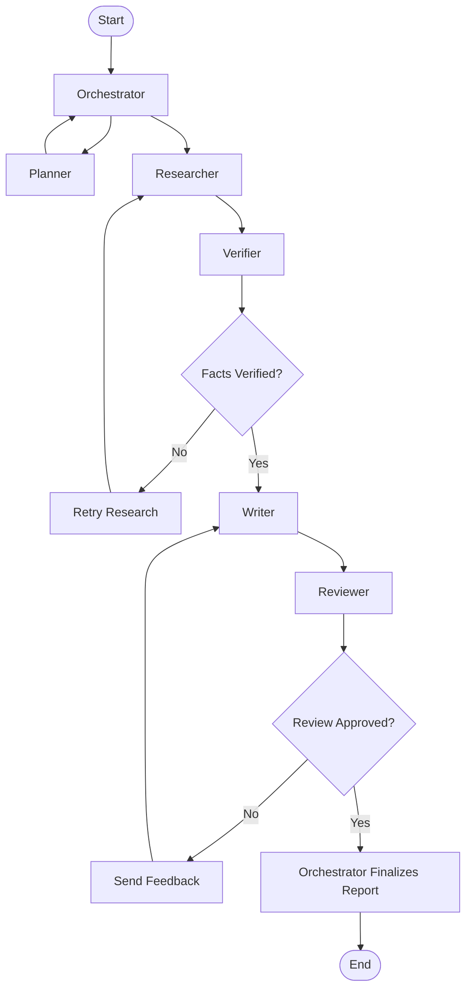

# Multi-Agent Collaboration System using Role-Based Agents

## 📌 Project Overview

This project demonstrates a Multi-Agent System in which multiple specialized agents collaborate to complete a shared task through communication, coordination, verification, and negotiation.

The system is developed using Python and implements a custom message-based communication framework.

Five agents work together to research a given topic, verify information, prepare a report, and review the final output. A central Orchestrator coordinates their activities and manages the communication between them.

The project also demonstrates common multi-agent challenges such as error propagation, deadlock, livelock, and coordination failures, along with mechanisms to reduce these problems.

## 🎯 Problem Statement

Complex tasks often require multiple responsibilities that cannot be handled efficiently by a single agent.

For example, preparing a research brief requires:
- Breaking the topic into smaller research tasks.
- Collecting relevant information.
- Checking the accuracy of collected facts.
- Preparing a structured report.
- Reviewing the final report.

This project uses specialized agents to divide these responsibilities and collaborate to produce a reliable research brief.

**Shared Task:** Generate a short, fact-checked research brief on topics such as Solar Energy and Electric Vehicles.

## 🤖 Multi-Agent Architecture

The system consists of five specialized agents and one central coordinator.

### Agent Roles

| Agent Name | Role | Responsibility |
|---|---|---|
| Planner | Task Planner | Breaks the main topic into smaller researchable subtopics. |
| Researcher | Information Collector | Collects facts and provides source information for each subtopic. |
| Verifier | Fact Checker | Cross-checks collected facts against an independent reference source. |
| Writer | Report Writer | Converts verified facts into a structured research brief. |
| Reviewer | Quality Reviewer | Checks report formatting, citations, and conclusion requirements. |
| Orchestrator | Coordinator | Assigns tasks, manages communication, handles retries, and controls the workflow. |

## 🔄 Communication and Coordination

The agents communicate through a custom MessageBus system.

Each message contains:
- Message ID
- Sender
- Receiver
- Communication type
- Message content
- Reply reference

The system supports six communication types:

| Communication Type | Purpose |
|---|---|
| REQUEST | Requests another agent to perform a task. |
| INFORM | Shares information or results. |
| PROPOSE | Submits a proposal or bid. |
| ACCEPT | Accepts a proposal. |
| REJECT | Rejects a proposal. |
| FAILURE | Reports an unsuccessful task. |

The MessageBus maintains a queue and delivers messages one at a time. It also records the communication history for debugging and evaluation.

## 🧩 Agent Collaboration Workflow

1. The Orchestrator receives the research topic.
2. The Planner divides it into smaller subtopics.
3. The Researcher collects facts for each subtopic.
4. The Verifier independently checks the collected facts.
5. If incorrect information is detected, the Orchestrator requests another attempt.
6. If the information remains incorrect after the retry limit, the affected facts are quarantined.
7. The Writer prepares a structured research brief.
8. The Reviewer checks citations and conclusion formatting.
9. If improvements are required, feedback is sent to the Writer.
10. The Orchestrator approves the final report or escalates the task if the review limit is reached.

### Workflow Diagram



## 🛠️ Technologies Used

- Python – Main programming language.
- MessageBus – Custom message-based communication system.
- Queue (`deque`) – Manages agent message delivery.
- Dataclasses – Defines structured messages and facts.
- Random – Simulates unreliable agent behaviour.
- Statistics – Calculates experimental performance.
- Matplotlib – Visualizes error propagation and communication costs.

The project uses Python's built-in libraries and does not require external AI APIs or frameworks.

## 🤝 Negotiation Between Agents

The project implements a Contract Net Protocol-style negotiation experiment.

Two bidder agents compete for a research task:

| Agent | Confidence | Cost |
|---|---:|---:|
| FastBot | 0.70 | 5 |
| CarefulBot | 0.95 | 20 |

The Manager sends a Call for Proposals (CFP) to both agents.

Each agent submits its confidence and estimated cost. The Manager calculates a utility score:

`Utility = Confidence - (Cost Weight × Cost)`

The agent with the highest utility receives the task.

Two situations are tested:

1. **Budget-conscious Manager:** Uses a higher cost weight, making FastBot more attractive.
2. **Quality-critical Manager:** Uses a lower cost weight, making CarefulBot more attractive.

This demonstrates how negotiation outcomes depend on the manager's priorities.

## ⚠️ Multi-Agent Failure Modes and Solutions

The project demonstrates three important failure modes.

### 1. Error Propagation

**Problem:** The Researcher may provide an incorrect fact due to a simulated decimal error.

Without verification, the incorrect fact can reach the Writer and become part of the final report.

**Solution:** The Orchestrator introduces a verification gate.

- The Verifier checks facts against an independent source.
- Incorrect facts are sent back for another research attempt.
- After two retries, unresolved facts are quarantined and excluded.

This reduces the chance of incorrect information spreading between agents.

### 2. Deadlock

**Problem:** Two agents may wait for each other indefinitely.

Example:

- Writer waits for Reviewer.
- Reviewer waits for Writer.

Neither agent can proceed, resulting in a deadlock.

**Solution:** The project implements a deadlock detection mechanism.

- A wait-for graph tracks agent dependencies.
- The system detects circular waiting conditions.
- A Guard selects the highest-priority agent in the cycle.
- That agent proceeds using provisional input.

The notebook also demonstrates an alternative design that breaks circular dependencies by allowing the Writer to start first.

### 3. Livelock

**Problem:** An agent may continuously reject another agent's output, causing repeated communication without progress.

Example: The Reviewer continuously requests additional details even after the Writer updates the report.

**Solution:** The Orchestrator uses a maximum review-round limit of three.

If the Reviewer continues rejecting the report, the system stops and escalates the task instead of continuing indefinitely.

## 🧪 Experiments and Evaluation

The notebook contains several experiments to evaluate agent coordination and reliability.

| Experiment | What It Demonstrates |
|---|---|
| Happy Path | Normal collaboration between all five agents. |
| Contract Net Negotiation | How agents compete for tasks based on confidence and cost. |
| Naive Pipeline | How incorrect facts propagate without verification. |
| Gated Pipeline | How verification, retries, and quarantine reduce error propagation. |
| Fault Rate Experiment | Compares system reliability at different Researcher fault rates. |
| Deadlock Demonstration | Shows circular waiting between agents. |
| Deadlock Guard | Demonstrates cycle detection and priority-based intervention. |
| Livelock Prevention | Limits repeated review cycles using a maximum round count. |

### Error Propagation Experiment

The project runs 300 trials for each Researcher fault rate.

Fault rates tested:

`0.0, 0.1, 0.2, 0.3, 0.4, 0.5, 0.6`

Two systems are compared:

- Naive Pipeline: Accepts Researcher results without verification.
- Gated Pipeline: Uses independent verification, retries, and quarantine.

The experiment measures:
- Percentage of reports containing incorrect facts.
- Average number of messages exchanged.
- Average number of quarantined facts.

The results are visualized using Matplotlib.

This experiment demonstrates the trade-off between improved reliability and additional communication overhead.

## 📊 Sample Execution Output

For the normal research workflow, the system produces a structured report containing:

- Research topic.
- Facts collected for individual subtopics.
- Source citations.
- Derived calculations where applicable.
- A conclusion summarizing the reviewed facts.
- Information about excluded unverified facts, if any.

For example, the Solar Energy topic is divided into:
- Cost
- Efficiency
- Adoption
- Durability

The Writer combines the verified information into a research brief, and the Reviewer checks whether citations and a conclusion are included.

The communication log displays how messages travel between agents during execution.

## 🔐 Reliability Mechanisms

The following mechanisms are implemented to improve system reliability:

| Mechanism | Purpose |
|---|---|
| Independent Verification | Checks facts against a second reference source. |
| Retry Mechanism | Requests corrected information when verification fails. |
| Quarantine | Excludes facts that remain incorrect after retries. |
| Message Limit | Prevents unlimited communication and runaway loops. |
| Deadlock Detection | Identifies circular waiting between agents. |
| Priority-Based Guard | Breaks deadlocks using provisional input. |
| Review Round Limit | Prevents endless review cycles. |
| Communication Logging | Records messages exchanged between agents. |

**Important:** The Verifier checks factual accuracy, while the Reviewer checks report structure and formatting. These are separate quality checks.

## 💻 Installation and Execution

### 1. Clone the Repository

```bash
git clone https://github.com/your-username/multi-agent-crew-activity.git
```

### 2. Navigate to the Project Folder

```bash
cd multi-agent-crew-activity
```

### 3. Install Required Libraries

```bash
pip install notebook matplotlib
```

The core multi-agent implementation uses Python's built-in libraries.

Matplotlib is optional and is used for generating experimental graphs.

### 4. Open the Notebook

```bash
jupyter notebook
```

Open:

`multi_agent_crew_activity.ipynb`

### 5. Run All Cells

Execute the notebook sequentially.

The notebook will:
- Initialize the MessageBus and agents.
- Execute the research workflow.
- Demonstrate agent communication.
- Run contract-based negotiation.
- Simulate incorrect research results.
- Compare verified and unverified pipelines.
- Test deadlock and livelock scenarios.
- Generate experimental graphs.

## 📁 Project Structure

```text
Multi-Agent-Collaboration/
│
├── multi_agent_crew_activity.ipynb
└── README.md
```

## 🎓 Learning Outcomes

Through this project, I learned:

- How to design a multi-agent system with specialized roles.
- How agents communicate using structured messages.
- How an Orchestrator coordinates multiple agents.
- How negotiation can be implemented using a Contract Net Protocol-style approach.
- How errors can propagate between collaborating agents.
- How independent verification improves reliability.
- How deadlocks and livelocks occur in multi-agent systems.
- How retry limits, priority rules, and message limits improve coordination.
- How communication overhead can be evaluated experimentally.

## ⚠️ Limitations

- Agents use predefined Python logic rather than independent LLM reasoning.
- Research information comes from predefined sample knowledge bases.
- The Verifier compares facts against a second simulated source, not a live external database.
- The negotiation experiment uses predefined confidence and cost values.
- Deadlock and livelock scenarios are simulated for demonstration.
- The system does not use actual CrewAI or AutoGen frameworks.

## 👨‍💻 Author

**Project:** Multi-Agent Collaboration System  
**Topic:** Unit IV – Multi-Agent Systems and Collaboration  
**Activity:** Designing a Team of Agents for a Task  
**Course Outcome:** CO IV  
**Language:** Python  
**Environment:** Jupyter Notebook / Google Colab

Developed as an academic activity to demonstrate role-based agents, communication protocols, negotiation, coordination, and multi-agent failure handling.
